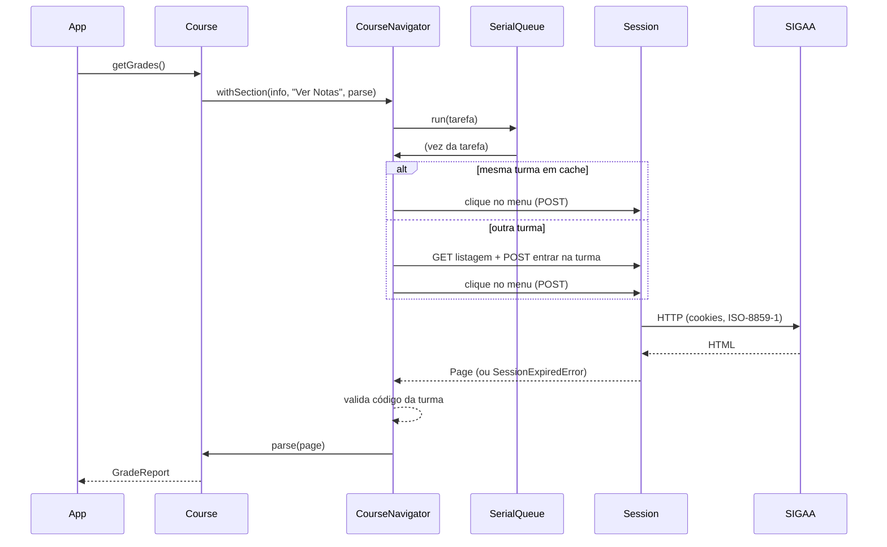

# Arquitetura

## Camadas

```
SigaaClient ── Course / CourseFile / NewsItem      API pública
     │
     ├─ CourseNavigator   navegação da turma virtual (cache da página atual)
     ├─ parsers/*         HTML → dados (funções puras)
     ├─ Session           autenticação, fila serial, erros tipados
     ├─ jsf/form          links jsfcljs e formulários
     └─ http/*            HttpClient, CookieJar, form-encoding
```

| Camada               | Responsabilidade                                                                  |
| -------------------- | --------------------------------------------------------------------------------- |
| `http/http-client`   | `fetch` com timeout, redirecionamentos manuais, retentativas (GET), decodificação |
| `http/cookie-jar`    | Cookies por domínio/caminho, `Secure`, `Max-Age`/`Expires`                        |
| `http/form-encoding` | `application/x-www-form-urlencoded` em ISO-8859-1                                 |
| `jsf/form`           | Extrai `jsfcljs(...)` do `onclick` e monta o formulário como um navegador faria   |
| `session`            | Detecta sessão expirada/erros, serializa a navegação                              |
| `course/navigator`   | Entra na turma, clica no menu, valida que a turma aberta é a pedida               |
| `parsers/*`          | Funções puras `Page → dados`, testáveis com HTML sintético                        |

## Por que a navegação é serializada

O SIGAA guarda no **servidor** a "turma atual" da sessão. Se duas chamadas
navegassem em turmas diferentes ao mesmo tempo, a resposta de uma poderia vir
da turma da outra. Toda navegação passa por uma fila (`SerialQueue`): uma de cada
vez, na ordem de chegada. Uma falha não trava as seguintes.

O `CourseNavigator` guarda a última página da turma (ela traz o menu lateral):
abrir outra seção **da mesma turma** custa uma única requisição. Ao trocar de
turma, ele reentra pela listagem — localizando a turma por
`período|código|turma`, porque os tokens do formulário mudam. Depois de cada
abertura valida o código da turma (`#linkCodigoTurma` ou `#relatorio h3`); se
vier a turma errada, descarta o cache e tenta uma vez de novo.

## Decisões

- **`fetch` nativo** (Node ≥ 20): sem cliente HTTP extra. Injetável pela opção `fetch`.
- **ISO-8859-1**: páginas decodificadas com `TextDecoder` e formulários enviados em Latin-1 (caracteres fora do Latin-1 viram `&#N;`, como nos navegadores).
- **Retentativas só em GET** e falhas transitórias (rede, 502/503/504), com _backoff_ exponencial. POST nunca é repetido: pode ter efeito colateral.
- **Redirecionamentos manuais**: até 10; `301/302/303` viram GET; `307/308` mantêm método e corpo; rebaixar HTTPS→HTTP é bloqueado.
- **Cookies não vazam**: o jar entrega cookies só ao domínio que os emitiu, então o download em `arquivos.ufsj.edu.br` segue sem o `JSESSIONID`.
- **Erros tipados** sem credenciais, cookies ou conteúdo de página.
- **Privacidade**: o "usuário" (CPF) de participantes é descartado no parser.
- **Parsers tolerantes**: colunas por rótulo (sem índices fixos) e ausência de dados vira lista vazia, não erro.

## Fluxo de uma chamada


